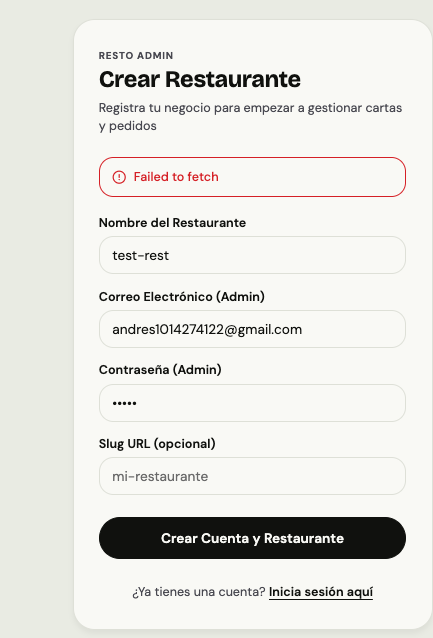
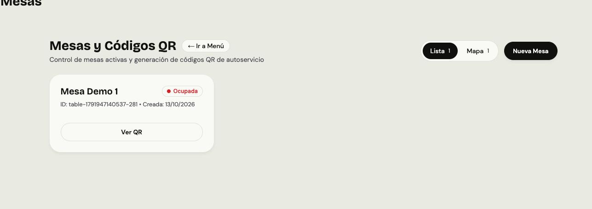
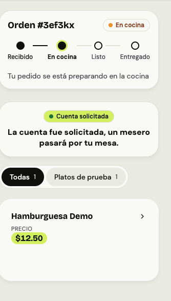
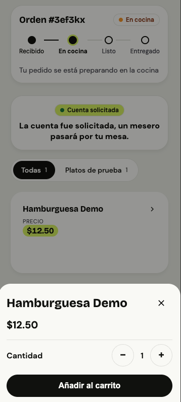

# RESTO — informe de revisión y cambios propuestos

Fecha: **13 de octubre de 2026**. Código revisado: `jcgmU/resto`, `main` en commit `a2c0f09`.

**Este documento registra hallazgos y trabajo pendiente. No implementa correcciones ni modifica código, configuración, dependencias o migraciones. Las casillas son criterios de aceptación para una implementación posterior.**

## Evaluación

RESTO ofrece una base útil de MVP: catálogo, mesas con QR, carrito, órdenes, cocina y registro de cobros. El recorrido positivo funcionó con backend y persistencia reales. No se recomienda operación comercial antes de corregir permisos, validación monetaria, sesión/mesa y concurrencia.

Fortalezas comprobadas: aislamiento de lectura entre restaurantes y sesiones; validación y rotación del QR; precio recalculado desde catálogo al confirmar; persistencia transaccional de orden e ítems; registro de pago idempotente; eventos de órdenes recibidos por WebSocket a través del gateway.

## Alcance y evidencia

| Comprobación ejecutada | Resultado |
|---|---|
| Tests existentes | 371 tests y 51 suites pasan |
| Build de paquetes compartidos y cinco servicios TypeScript | Pasa |
| Build de ambos frontends Next | Pasa con dependencias locales disponibles; ver limitaciones |
| Navegador: login, categoría, producto, mesa, QR, detalle, carrito y envío | Pasa |
| Navegador: IN_KITCHEN → READY → DELIVERED, atención y registro de cobro | Pasa; pedido de dos unidades del mismo producto de 12.50, total 25 |
| API real: 30 verificaciones, incluyendo controles de acceso y casos negativos | 22 pasan, 8 fallan |
| QR abierto ocho veces simultáneamente, tres repeticiones | Falla: 8, 5 y 7 sesiones distintas por mesa |
| KDS con carga de órdenes interrumpida | Falla: muestra «En vivo» y columnas vacías pese a orden pendiente |
| Health de gateway con dependencias locales no disponibles | Falla: HTTP 200 y todos los componentes «ok» |
| axe WCAG2A/AA: registro y KDS | Cero violaciones en estados observados; no auditoría completa |
| axe WCAG2A/AA: menú móvil, 375 × 812 | Una violación crítica `aria-valid-attr-value`: `#tab-all` referencia `tabpanel-all` inexistente |

Las pruebas negativas se realizaron en restaurantes QA locales separados. No se probó el despliegue externo. Los tests verdes existentes no demuestran integración segura: algunos usan adaptadores falsos que no coinciden con comportamiento real.

## Correcciones prioritarias, confirmadas en ejecución

### R01 — Crítica: escritura de catálogo permitida a invitados

**Observado:** un token guest obtenido por QR creó una categoría mediante GraphQL, HTTP 200. Gateway valida JWT pero resolvers no autorizan mutaciones por rol. Lectura de código confirma que crear/editar/eliminar catálogo usa la misma ausencia de control.

**Referencias:** `services/gateway/src/routes/routeTable.ts:22`, `services/catalog/src/interfaces/graphql/context.ts:10`, `services/catalog/src/interfaces/graphql/resolvers.ts:81`.

- [ ] Autorizar mutaciones dentro del servicio de catálogo para ADMIN/MANAGER, según política de roles.
- [ ] Conservar consulta de menú para guest.
- [ ] Probar matriz de roles para crear, editar y eliminar categorías, productos y modificadores.
- [ ] Guest debe recibir denegación y catálogo debe permanecer intacto.

### R02 — Alta: cantidades y cobros negativos

**Observado:** cantidad -1 fue aceptada; confirmación produjo orden de -12.50 y checkout registró pago de -12.50.

**Referencias:** `services/ordering/src/interfaces/http/cart.routes.ts:31`, `services/ordering/src/application/CartUseCases.ts:63`, `services/ordering/src/domain/pricing.ts:98`, `services/ordering/src/application/ConfirmCheckout.ts:68`.

- [ ] Validar cantidad como entero finito positivo, con máximo definido, en entrada HTTP y dominio.
- [ ] Rechazar cero, negativos, fracciones y cantidades fuera de rango.
- [ ] Proteger totales y montos con invariantes y restricciones de persistencia.
- [ ] Ningún caso inválido debe crear orden o pago ni reducir una cuenta existente.

### R03 — Alta: pedidos permitidos después del cobro

**Observado:** después de cobrar y cerrar sesión, token guest anterior permitió añadir y confirmar otra orden de 12.50, HTTP 201.

**Referencias:** `services/ordering/src/application/OrderUseCases.ts:63`, `services/ordering/src/application/ConfirmCheckout.ts:45`, `services/ordering/src/application/ConfirmCheckout.ts:95`.

- [ ] Consultar estado autorizado de sesión antes de escribir carrito, pedidos y llamadas.
- [ ] Introducir barrera de cierre/liquidación antes de calcular cuenta final.
- [ ] Rechazar nuevos pedidos durante liquidación y después del cierre.
- [ ] Probar pedido y cobro simultáneos: ningún pedido aceptado debe quedar fuera del total cobrado.

### R04 — Alta: varias sesiones activas para una mesa

**Observado:** ocho aperturas concurrentes del mismo QR produjeron 8, 5 y 7 sesiones distintas en tres repeticiones. También aparecieron dos tarjetas para misma mesa en checkout; cerrar una dejó otra activa.

**Referencia:** `services/session/src/application/SessionUseCases.ts:33` realiza búsqueda y creación separadas.

- [ ] Crear/reutilizar sesión de forma atómica por `tenantId + tableId`.
- [ ] Todos los comensales que abren el mismo QR deben compartir sesión activa según política del MVP.
- [ ] Repetir aperturas simultáneas debe producir una sesión, sin carritos ni cuentas fragmentados.
- [ ] Estado «Mesa liberada» debe corresponder a ausencia de sesiones activas.

### R05 — Alta: carrito pierde añadidos concurrentes

**Observado:** carrito con cantidad inicial 1 recibió ocho añadidos simultáneos, todos HTTP 201; cantidad final 2, esperado 9.

**Referencias:** `services/ordering/src/application/CartUseCases.ts:18`, `services/ordering/src/infrastructure/persistence/RedisCartRepository.ts:71`, `services/ordering/src/application/OrderUseCases.ts:99`.

- [ ] Hacer combinación/incremento de líneas de forma atómica en Redis.
- [ ] Versionar o intercambiar snapshot al confirmar, preservando añadidos posteriores.
- [ ] Probar concurrencia de varios comensales, modificaciones y confirmación.
- [ ] Ocho añadidos sobre cantidad 1 deben conservar cantidad 9.

### R06 — Alta: mesa del pedido controlada por cliente

**Observado:** confirmar con `tableId` distinto al de sesión guardó pedido atribuido a mesa ajena.

**Referencias:** `services/ordering/src/interfaces/http/cart.routes.ts:82`, `services/ordering/src/application/OrderUseCases.ts:88`, `services/ordering/src/interfaces/http/checkout.routes.ts:57`.

- [ ] Derivar mesa desde sesión validada; no confiar en identificación enviada por cliente.
- [ ] Aplicar regla a órdenes, checkout y llamadas de servicio.
- [ ] Intento de sustituir mesa debe rechazarse o conservar mesa autorizada.

### R07 — Alta: refresh real no funciona

**Observado:** refresh token recién emitido devolvió HTTP 401 `INVALID_CREDENTIALS`. Emisión guarda SHA256; renovación busca `hash_<raw>`. Fake usado en tests oculta diferencia.

**Referencias:** `services/identity/src/infrastructure/security/JwtTokenIssuer.ts:12`, `services/identity/src/application/RefreshSession.ts:27`, `apps/admin-dashboard/src/lib/api.ts:72`.

- [ ] Centralizar cálculo de hash entre emisión y lookup.
- [ ] Probar issuer y repositorio reales: primera renovación funciona, reutilización falla.
- [ ] Coordinar refresh concurrente en frontend mediante promesa compartida; este riesgo adicional se confirmó por lectura, no por prueba dinámica de expiración concurrente.
- [ ] Mantener panel y socket operativos al caducar access token, sin logout inesperado.

### R08 — Alta al desplegar: posible bypass de gateway

**Observado localmente:** llamada directa a Catalog sin JWT y con headers de identidad falsos creó categoría. Compose publica servicios internos y bases en host.

**Referencias:** `docker-compose.yml:43`, `services/catalog/src/interfaces/graphql/context.ts:11`, `services/ordering/src/interfaces/http/middleware/requireGatewayIdentity.ts:19`.

- [ ] Publicar únicamente servicios de entrada necesarios; puertos locales de desarrollo deben usar loopback.
- [ ] Autenticar comunicación interna o validar identidad firmada.
- [ ] Servicios internos deben rechazar identidad no autenticada aunque se envíen headers de rol/tenant.
- [ ] Confirmar configuración de red del despliegue, sin inferir exposición pública a partir de prueba local.

### R09 — Alta operativa: cocina vacía oculta errores

**Observado:** interrumpir GET de órdenes dejó KDS con «En vivo» y cero pedidos. Restaurar petición y recargar mostró orden pendiente. Código también ignora errores al avanzar orden o resolver llamada.

**Referencia:** `apps/admin-dashboard/src/app/(panel)/kds/page.tsx:27`, `:130`, `:143`.

- [ ] Mostrar fallo por fuente, último snapshot y reintento; no presentar fallo como cero pedidos.
- [ ] Informar al operador cuando avance/resolución falla.
- [ ] Reconciliar snapshot al reconectar WebSocket y actualizar token de conexión.
- [ ] Probar pedidos que llegan durante desconexión. Falta de recuperación de eventos está sustentada por código; no se presenta como prueba de reconexión completada.

### R10 — Media: botón «Pagar» del cliente sin resultado

**Observado:** botón visible intenta registrar CASH, gateway rechaza correctamente guest con HTTP 403; interfaz silencia error.

**Referencias:** `apps/client-pwa/src/app/t/[tenantId]/[tableId]/menu/page.tsx:202`, `services/gateway/src/routes/routeTable.ts:54`.

- [ ] Definir política: petición de cuenta atendida por personal o pago digital con proveedor.
- [ ] Mientras no exista pago del cliente, ocultar acción que no puede completar y conservar petición de cuenta.
- [ ] Mostrar estados y errores visibles.
- [ ] No conceder a guest permiso para registrar cobros del personal como solución visual.

### R11 — Media: error de checkout invisible sin cuenta

**Observado:** seleccionar sesión activa sin pedidos devolvió HTTP 404; pantalla no mostró error. Mensaje se renderiza dentro de rama `bill &&`, que no existe cuando carga falla.

**Referencia:** `apps/admin-dashboard/src/app/(panel)/checkout/page.tsx:157`.

- [ ] Mostrar carga, cuenta vacía y error/reintento independientemente de existencia de bill.
- [ ] Diferenciar sesión sin consumo de fallo de red/servidor.

### R12 — Media: health no verifica disponibilidad

**Observado:** gateway con upstreams locales no disponibles respondió HTTP 200 y siete componentes «ok». Respuesta contiene valores literales.

**Referencia:** `services/gateway/src/app.ts:29`.

- [ ] Separar liveness y readiness.
- [ ] Readiness debe consultar dependencias necesarias con timeout y devolver estado degradado/503.
- [ ] Probar caída y recuperación de servicios, PostgreSQL y Redis.

## Observaciones del usuario y capturas originales

Capturas enviadas por usuario durante revisión de RESTO. Se incluyen sin edición. Evidencia visual documenta experiencia observada; no implica que correcciones propuestas estén implementadas.

### U01 — Registro: «Failed to fetch»

Backend no estaba accesible durante esa parte del arranque local; registro real funcionó tras levantar servicios. No se atribuye captura por sí sola a error del endpoint de registro. Mensaje mostrado sí resulta poco útil.

- [ ] Mostrar explicación y reintento cuando servicio no está disponible, sin perder datos del formulario.
- [ ] Documentar arranque y comprobación de dependencias; diferenciar error de red, validación y credenciales.

### U02 — Mesas: «Lista» y «Mapa» no explican diferencia

Lista presenta detalles y QR; Mapa presenta mismas mesas en cuadrícula con leyenda de ocupación. No utiliza coordenadas ni representa plano físico. Con una mesa, diferencia aporta poco y nombre «Mapa» genera expectativa distinta.

- [ ] Renombrar vistas a «Detalles» y «Estado de mesas», o implementar plano físico si es requisito.
- [ ] Explicar función de cada vista y conservar acciones disponibles en ambas.

### U03 — Filtros redundantes y cuenta durante preparación

**Todas / Platos de prueba:** Todas reúne categorías; una sola categoría produce mismo contenido. «Platos de prueba» es nombre de categoría demo, no función distinta.

- [ ] Ocultar filtro «Todas» cuando solo haya una categoría, o simplificar navegación equivalente.
- [ ] Con varias categorías, comprobar que filtro individual reduce catálogo correctamente.

**Cuenta solicitada / En cocina:** son estados independientes, pero interfaz no explica que atención y preparación continúan en paralelo.

- [ ] Separar visualmente estado del pedido, atención y cuenta.
- [ ] Usar mensaje claro, por ejemplo: «Mesero avisado. Tu pedido sigue en preparación».
- [ ] Definir cuándo se permite pedir cuenta y cuándo comienza liquidación; impedir nuevos pedidos durante liquidación.

### U04 — Detalle/carrito mientras pedido sigue en cocina

Usuario percibe que puede cambiar pedido ya en preparación. Código conserva platos de orden confirmada: carrito permite preparar **otra orden**, porque confirmación genera nuevo orderId. Interfaz no comunica distinción y seguimiento conserva solo última orden en memoria.

- [ ] Indicar «Pedido enviado; ya no puede editarse» y no ofrecer edición de platos confirmados.
- [ ] Si restaurante permite consumos adicionales, usar acción explícita «Agregar otro pedido», separada del seguimiento anterior.
- [ ] Si requisito es impedir nuevos pedidos durante preparación, bloquear carrito hasta finalizar; decisión debe quedar documentada antes de implementación.
- [ ] Mostrar todas las órdenes de sesión y recuperar seguimiento al recargar.
- [ ] Al solicitar/cerrar cuenta, aplicar política coherente en UI y backend, no únicamente desactivar botón.

## Otros puntos de frontend y cobertura

Hallazgos siguientes se sustentan en inspección de código salvo donde se indica prueba automática; necesitan escenarios de aceptación reales:

- [ ] Validar errores HTTP/GraphQL: una avería de catálogo no debe mostrarse como «No hay platos» (`apps/client-pwa/src/lib/api.ts:174`).
- [ ] Esperar resultado de añadir producto antes de cerrar detalle; error debe quedar visible (`apps/client-pwa/src/components/ProductDetailSheet.tsx:118`).
- [ ] Actualizar guard y controles ante expiración guest durante pantalla abierta (`apps/client-pwa/src/components/GuestSessionGuard.tsx:14`).
- [ ] Corregir `aria-controls="tabpanel-all"` para referenciar panel real; fallo detectado con axe.
- [ ] Evitar superposición del botón flotante de carrito sobre «Pedir la cuenta» en móvil; observada durante recorrido.
- [ ] Usar controles de teclado accesibles en tarjetas interactivas y jerarquía coherente de títulos.
- [ ] Sustituir scripts lint que hacen `echo` por análisis real y validación en CI.
- [ ] Incorporar tests de contrato con adaptadores reales y escenarios de permisos, concurrencia, sesión cerrada, fallos y reconexión.
- [ ] Corregir documentación del E2E: README anuncia `node e2e.mjs`, pero archivo no existe en versión revisada.

## Requisitos y funciones pendientes

Stack documentado: Node20+, pnpm9, PostgreSQL16, Redis7, gateway + Identity/Catalog/Session/Ordering y dos frontends Next. Requiere migraciones, URLs de servicios y flags coherentes.

Antes de operación comercial: secretos adecuados, HTTPS, red interna, backups con restauración probada, logs, alertas, readiness y recuperación ante pérdida de eventos. Publicación después del commit de base de datos sin outbox puede dejar orden persistida sin notificación; este riesgo está sustentado por lectura.

No implementado según README/código revisado: pasarela de pago real, historial de cobros, ajustes, analíticas, gestión de empleados en panel y operación offline. Elegir CASH/CARD/OTHER registra método; no procesa transacción financiera. Invitación/aceptación de empleados y logout necesitan revisión de contrato e implementación.

## Orden sugerido de implementación

1. R01/R02/R08: autorización, integridad monetaria y límite de confianza interno.
2. R03–R06: sesión única, cierre, mesa autorizada y carrito concurrente.
3. R07/R09/R12: autenticación, recuperación de cocina y observabilidad.
4. R10/R11/U01–U04: política de cuenta/pedidos, feedback y claridad visual.
5. Accesibilidad, CI, trazabilidad y funciones comerciales pendientes.

Cada grupo debe entregarse con pruebas de aceptación reales. Este PR no declara ninguno resuelto.

## Limitaciones de revisión

- Instalación limpia exacta no verificada: registro corporativo rechazó instalación y registro público falló por DNS. Se reutilizaron dependencias locales.
- Builds y pruebas de frontend usaron Next14.2.35 disponible, frente a Next14.2.15 declarado por repositorio; lockfile no fue actualizado.
- Prisma se regeneró para plataforma local durante pruebas. Build Docker completo no terminó por fallo DNS al descargar pnpm; servicios reales se compilaron y ejecutaron localmente con PostgreSQL/Redis.
- Sin pruebas de carga, auditoría fiscal ni evaluación exhaustiva de seguridad/despliegue externo.
- Captura de registro no demuestra fallo permanente de negocio: tras resolver arranque local, registro pasó.
- R01–R12 describen hallazgos confirmados en ejecución, con alcance preciso por caso. Recomendaciones adicionales de reconexión, refresh concurrente y outbox se distinguen como revisión estática.
