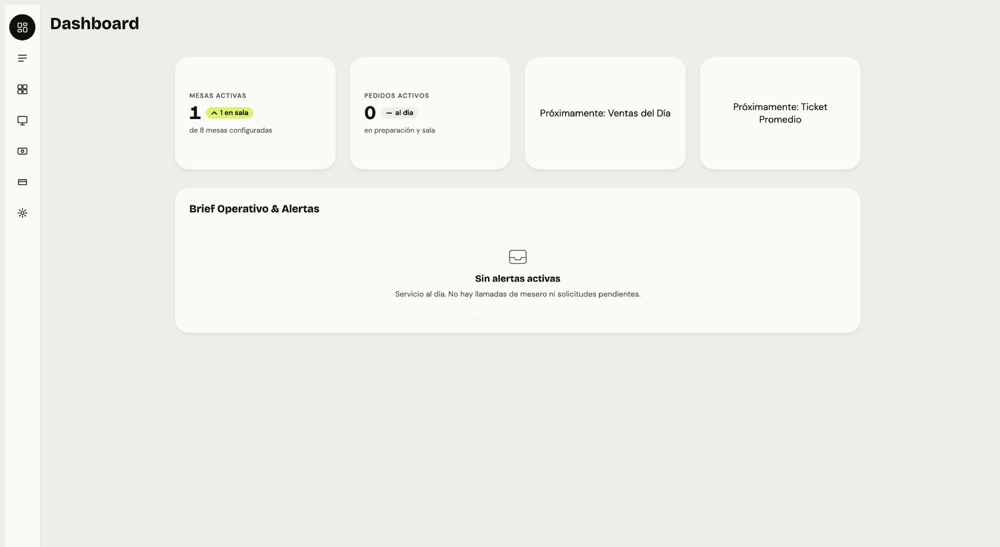
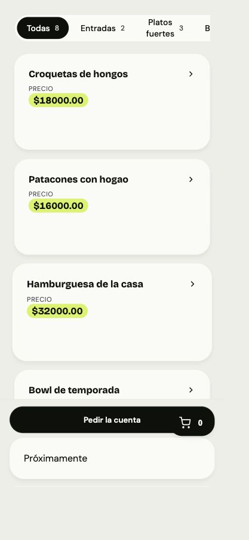
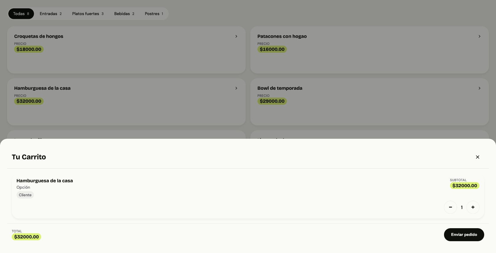
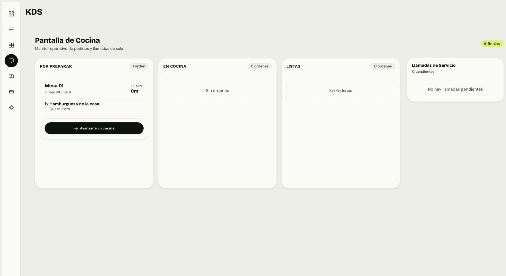

# Review PR #2 — código y UI

Fecha: 2026-10-23, America/Bogota. Cuenta GitHub consultada: `andress1014`.

PR: https://github.com/jcgmU/resto/pull/2 · HEAD revisado: `65ffd61bbe7ca61da58791abfde75faaa37200b8`.

## Dictamen y alcance

El diff del PR modifica únicamente `apps/client-pwa/src/app/t/[tenantId]/[tableId]/menu/page.tsx` (+3/−29): reutiliza `loadMenu()` para la carga inicial. No encontramos una regresión bloqueante demostrada en ese cambio. Sí elimina el cleanup `isMounted`; conviene cancelar/ignorar respuestas obsoletas tanto al cargar como al reintentar. No afirmamos contaminación entre restaurantes demostrada: Next puede remontar la página al cambiar segmentos.

La revisión ampliada cubre gateway, identity, catalog, session, ordering, contratos compartidos, dos apps, kit UI y configuración de despliegue/pruebas. Los defectos siguientes son **preexistentes en la base del PR**. No deben publicarse como regresiones introducidas por sus tres líneas nuevas. Aprobar este refactor no certifica la corrección del resto del sistema.

No se modificó código del producto, no se añadieron tests y no se publicó review/comentario en GitHub. Sin staging, commits, push, merge ni peticiones a entornos productivos. Evidencia y propuestas guardadas en esta carpeta. Checkout aislado: `/tmp/resto-pr2-review`.

## Hallazgos de mayor impacto

P1 significa corregir con prioridad alta; P2, defecto funcional/seguridad relevante. Las condiciones y límites están explícitos en los informes de dominio.

| Prioridad | Problema y condición reproducible | Ubicación principal | Corrección concreta |
|---|---|---|---|
| P1 | JWT guest obtenido por QR puede crear/borrar/editar catálogo. Mutación de categoría atravesó gateway y devolvió 200. | `services/catalog/src/interfaces/graphql/resolvers.ts:81`; `services/gateway/src/routes/routeTable.ts:22` | Autorizar mutations por rol en catálogo; permitir al guest las queries necesarias. |
| P1 | Disponibilidad actualiza producto de otro tenant porque filtra únicamente por ID. Asociar grupos/categorías tampoco comprueba siempre propietario. | `services/catalog/src/infrastructure/persistence/PrismaProductRepository.ts:152` y `:170` | Incluir tenant en escrituras y validar ambas entidades de una relación. |
| P1 | Guest puede conservar header `x-user-id` arbitrario y leer perfil ajeno en `/identity/me`. Reproducido por HTTP con repositorios en memoria. | `services/gateway/src/proxy/httpProxy.ts:11`; `services/identity/src/app.ts:99` | Eliminar headers de identidad externos, reconstruir desde claims y consultar usuario bajo tenant. |
| P1 | Cantidad `-3` produce pedido y pago de `-30`; puede reducir cuenta compartida. Confirmado de punta a punta HTTP local. | `services/ordering/src/interfaces/http/cart.routes.ts:31`; `services/ordering/src/domain/pricing.ts:99` | Validación runtime y de dominio: entero positivo acotado; restricciones DB. |
| P1 | Checkout permite mostrar cuenta A y enviar confirmación para sesión B si respuestas llegan fuera de orden. | `apps/admin-dashboard/src/app/(panel)/checkout/page.tsx:70` y `:86` | Correlacionar respuesta con sesión, cancelar cargas anteriores y exigir coincidencia antes de cobrar. |
| P1 | Tras checkout, JWT guest todavía permite crear órdenes para sesión pagada; pago idempotente conserva importe anterior. | `services/ordering/src/application/OrderUseCases.ts:63`; `services/ordering/src/application/ConfirmCheckout.ts:59` | Estado de cobro autoritativo y exclusión por sesión entre orden/cancelación/cobro. |
| P1 | Refresh recién emitido siempre falla: emisión usa SHA256, búsqueda usa prefijo `hash_`. Registro 201 → refresh 401 reproducido. | `services/identity/src/application/RefreshSession.ts:27`; `services/identity/src/infrastructure/security/JwtTokenIssuer.ts:12` | Compartir implementación de hash real; verificar emisión → renovación con issuer real. |
| P1 | Después de reparar hash, refresh paralelo puede borrar tokens nuevos por segunda renovación fallida. Reproducido con respuestas controladas. | `apps/admin-dashboard/src/lib/api.ts:79` y `:113` | Una promesa compartida de renovación; rotación consumida de forma atómica en servidor. |
| P1 | Dos aperturas QR concurrentes crean dos sesiones para la misma mesa, separando carritos/cuentas. | `services/session/src/application/SessionUseCases.ts:33`; `services/session/src/infrastructure/redis/RedisTableSessionRepository.ts:30` | Operación get-or-create atómica por tenant/mesa. |
| P1 | Confirmar pedido borra el carrito completo después de guardar snapshot; adiciones de otro comensal durante confirmación desaparecen. | `services/ordering/src/application/OrderUseCases.ts:96` | Consumo atómico/versionado del snapshot y recuperación idempotente tras fallos. |
| P1 | Staff evita política manager/admin de cancelación usando PATCH `/status` con `CANCELLED`. | `services/ordering/src/interfaces/http/orders.routes.ts:86` | Aplicar política al cambio de estado en application, cualquiera sea endpoint. |
| P1 | KDS convierte rechazo de todas las cargas en tablero vacío: no inspecciona rejected de `Promise.allSettled`. | `apps/admin-dashboard/src/app/(panel)/kds/page.tsx:27` | Error bloqueante recuperable para pedidos y errores parciales explícitos. |
| P2 | Reconexión KDS marca “En vivo” sin recargar snapshot: pedidos creados durante desconexión pueden faltar. | `apps/admin-dashboard/src/app/(panel)/kds/page.tsx:76` | Reconciliar HTTP al reconectar; considerar replay/cursor. Evidencia estática, no certificada con persistencia real. |
| P1 funcional | PWA mostró hamburguesa con queso a **$32.000** en carrito; confirmación y checkout registraron **$36.000**. | `apps/client-pwa/src/app/t/[tenantId]/[tableId]/menu/page.tsx:134`; `services/ordering/src/application/CartUseCases.ts:48` | Snapshot enriquecido por servidor con IDs exactos; contrato único para nombre/delta de cada extra. |

### Configuración con impacto condicionado al despliegue

Compose publica servicios internos 4001–4004 en todas las interfaces; estos aceptan headers de identidad sin verificar JWT. Si host es alcanzable, se evita gateway. También publica Redis con `protected-mode no`, sin autenticación. Usar red privada y override local enlazado a loopback; autenticar llamadas internas donde corresponda.

Compose configura `NODE_ENV=production` pero acepta secreto JWT conocido si falta variable. Es una configuración insegura distribuida, no una afirmación sobre secretos de ningún servidor inspeccionado. Fallar arranque sin secreto externo en ese modo. Ubicaciones: `docker-compose.yml:49`, `services/gateway/src/config/index.ts:7`, `infra/redis/redis.conf:3`.

## Más hallazgos y evidencia por dominio

- [Backend: 12 hallazgos](backend.md): autorización/tenant, sesiones QR, categorías, login suspendido, logout 404 y health ficticio.
- [Ordering: 13 hallazgos](ordering.md): pérdidas por concurrencia, estados cancelados que reaparecen, tableId manipulable, notas fusionadas, rooms sin tenant, JWT expirado en socket, eventos después del commit y llamadas obsoletas tras cobro.
- [Frontend: 8 hallazgos](frontend.md): carrera checkout, refresh paralelo, KDS, teclado, errores GraphQL tratados como vacío, add-to-cart silencioso y expiración guest sin reacción.

Matices importantes: no afirmar doble pedido SQL por doble confirmación: PK de OrderItem impide segundo insert del mismo snapshot, aunque recuperación ante fallo posterior sigue incorrecta. Tampoco atribuir la falta de evento durante este recorrido visual a backend: el harness tenía un wrapper de eventos incorrecto. La necesidad de sincronizar KDS al reconectar se demuestra por su handler, independientemente del harness.

### Ampliación del defecto de modificadores observada en navegador

`ProductDetailSheet` sí arma `{groupId, optionId, optionName, priceDelta}`. La página convierte `display.modifierNames` a strings. Ordering espera objetos con `optionName` y no puede recuperar ni nombre ni delta; carrito muestra “Opción” y delta cero. Al confirmar, `GraphqlCatalogValidationAdapter` recupera valores reales y precio aumenta. Además, cuando caller sí manda objetos, backend elige siempre primer nombre sin comparar IDs (O8).

Evidencia: hamburguesa 32.000 + queso 4.000 → carrito 32.000, orden real 36.000; GET `/v1/orders` y cuenta administrativa confirmaron extra `Queso extra`, delta 4.000. Checkout tampoco detalla ese extra: línea dice 32.000 mientras subtotal dice 36.000. Corregir contrato y desglose completo antes de pulir presentación.

## Revisión visual

Recorrido Chrome local: login, menú admin, dashboard, cocina, checkout, QR/menú móvil, detalle, extras, carrito y confirmación. Admin con flags kitchen-display/payments activos; PWA con payments desactivado. Móvil verificado mediante DOM: `innerWidth=375`, `scrollWidth=375`.

Problemas observados:

1. **Jerarquía de acciones:** “Pedir la cuenta” domina antes de pedir comida; carrito flotante se superpone sobre ese botón. Hay intersección real de sus rectángulos. Cambiar a barra única “Ver pedido · cantidad · total” y cuenta secundaria.
2. **Identidad y contexto ausentes:** carta entra directamente en categorías, sin restaurante ni mesa visibles. Agregar encabezado breve y contexto de sesión.
3. **Densidad baja:** tarjeta alta para nombre/precio; dashboard reserva dos grandes áreas a funciones no disponibles. Preferir filas compactas para catálogo administrativo y ocultar módulos no activos.
4. **Navegación poco descubrible:** rail sólo muestra iconos; títulos duplicados en menú y KDS. Usar labels visibles y un título por pantalla.
5. **Precio tratado como KPI:** “PRECIO” + chip lima repetido en cada plato; cantidades COP sin separadores y dos decimales. `Intl.NumberFormat` según moneda/locale del tenant.
6. **Consistencia funcional:** carrito/checkout no explican extras; acciones y errores necesitan feedback junto al control que los dispara.
7. **Accesibilidad:** productos/mesas son `article onClick` sin acceso por teclado; modales PWA sin nombre accesible. Usar controles nativos y etiquetas explícitas.

Ausencia de fotos en esta corrida depende de datos sintéticos sin imageUrl; no se considera un fallo del componente. Aun con foto, falta jerarquía de carta y descripción.

Capturas reales de esta revisión:

## Direcciones de UI

Las tres propuestas comparan el mismo servicio y carta; datos de ejemplo, no métricas reales. El comparador interactivo acompaña respuesta de revisión.

| Dirección | Cambio concreto | Costo relativo | Uso recomendado |
|---|---|---|---|
| Operación | Sidebar con etiquetas, cola de atención, mesas compactas, estado explícito; carta con filas, descripción y un CTA de pedido. | Medio | Base recomendada para admin, meseros y cocina. |
| Bistró | Navegación horizontal, lista de servicio; identidad editorial cálida y tipografía con personalidad en carta. | Medio/alto | PWA cuando marca y experiencia gastronómica son prioridad. |
| Lima esencial | Mantiene paleta, reduce tarjetas vacías, etiqueta navegación y ordena mesa/estado/acción. | Bajo/medio | Evolución con menor migración visual. |

Recomendación: **Operación para admin + identidad editorial de Bistró para PWA**, compartiendo tokens básicos, estados y componentes accesibles. Menor esfuerzo: Lima esencial. Decisión visual no implica implementar rediseño en este review.

## Validación ejecutada y límites

Tests existentes, ejecutados con Jest local `--runInBand --silent`; sin nuevos tests. Shared-types/UI compilados con TypeScript; gateway compilado para revisión local.

| Paquete | Resultado actual |
|---|---|
| Admin | 99/99 pasan, 14 suites |
| PWA | 74/74 pasan, 14 suites |
| UI components | 82/82 pasan, 5 suites |
| Identity | 15/15 pasan, 2 suites |
| Gateway | 17/17 pasan, 2 suites |
| Catalog | 12 pasan; 1 falla por motor Prisma Windows sin darwin-arm64 |
| Session | 10 unit tests pasan; 2 suites bloqueadas por resolución local de ioredis |
| Ordering | 27 unit tests pasan; 6 suites bloqueadas por cliente Prisma sin generar |

**287 tests en paquetes completamente verdes**, otros 49 unit/integration parciales pasan. No se certifica suite completa ni build de producción completo. Primer intento identity/gateway falló por artefactos shared-types faltantes/viejos; tras aislar links de workspace y compilar shared-types, ambas suites pasaron. No clasificar ese primer fallo como bug del PR.

Dependencias se reutilizaron desde instalación existente. Next instalado es 14.2.35, mientras manifests/lock declaran 14.2.15: revisión visual no representa instalación limpia exacta del lock. `pnpm` local tiene enlace roto y descarga de corepack agotó timeout; no se reinstalaron dependencias. Falta reproducir install frozen + generate Prisma + builds en entorno limpio/CI.

UI y reproducciones HTTP usan **aplicaciones/casos de uso reales con repositorios en memoria**, más adaptadores HTTP catálogo/sesión reales. Se aisló import Prisma no usado para poder correr harness. Persistencia, constraints SQL, TTL Redis y entrega durable no certificados. Hallazgos de esos adaptadores se apoyan en lectura del código y esquema y se identifican así en anexos. Docker images locales existentes eran stubs; no se usaron para declarar E2E real.

En GitHub, único check visible del PR era GitGuardian exitoso. No hay workflows de build/test versionados. Scripts lint son `echo`, sin análisis. Recomendación concreta: CI de instalación frozen, generación Prisma por runtime, compilación/test, adaptadores con Postgres/Redis reales y pruebas de navegador de dinero, concurrencia, reconexión y teclado.

## Orden recomendado de trabajo

1. Roles, aislamiento tenant, saneamiento headers y configuración de red/secretos.
2. Integridad de dinero: cantidades, contrato extras, selección de mesa, cierre de cuenta y pedidos posteriores.
3. Concurrencia de QR/carrito/estados y sesión/refresh.
4. Recuperación de KDS, eventos, errores visibles y teclado.
5. Dirección visual elegida y migración por pantallas, con comparación de estados y breakpoints.

No convertir todos estos cambios en el pequeño PR de loader. Crear unidades separadas con regresión verificable y cambios revisables. Este informe deja evidencia para planificar ese trabajo.
